# Invoice Management Microservices Application

**Author:** BAYI Mostapha, II-BDCC-3

## Objective

Build an application based on a **microservices architecture** that manages **invoices** containing **products** and belonging to a **customer**.

## Resources

- [Part 1](https://www.youtube.com/watch?v=kOVHzN8I8e8)
- [Part 2](https://www.youtube.com/watch?v=-iM3J_mgqlM)
- [Config service (video)](https://www.youtube.com/watch?v=-G2rcLMO1gQ)
- [Reference GitHub repository](https://github.com/mohamedYoussfi/micro-services-app)

## Architecture

```
                       ┌────────────────────────┐
                       │     Config Service     │
                       │ (central configuration)│
                       └───────────┬────────────┘
                                   │
 Client ──► Gateway ──► ┌──────────┴───────────┐
          (Spring Cloud │   Discovery Service  │
            Gateway)    │       (Eureka)       │
                        └──────────┬───────────┘
                                   │
          ┌────────────────────────┼────────────────────────┐
          ▼                        ▼                        ▼
  customer-service         inventory-service         billing-service
    (customers)               (products)          (invoices, OpenFeign)
                                                   │            │
                                                   └─► calls ───┘
                                           customer-service & inventory-service
```

## Microservices

| Service | Role |
|---|---|
| **customer-service** | Customer management |
| **inventory-service** | Product management |
| **gateway-service** | Single entry point (Spring Cloud Gateway) |
| **discovery-service** | Eureka directory (service registration and discovery) |
| **billing-service** | Invoice management, communicates through **OpenFeign** |
| **config-service** | Centralized configuration (Spring Cloud Config, Git repository) |

## Technologies

- Java / Spring Boot
- Spring Data JPA, Spring Data REST
- Spring Cloud Gateway
- Spring Cloud Netflix Eureka
- Spring Cloud OpenFeign
- Spring Cloud Config
- Spring Boot Actuator
- H2 Database
- Lombok, Maven

---

## Work Done

### 1. `customer-service` microservice

Customer management (entity, repository, REST exposure) with first tests.

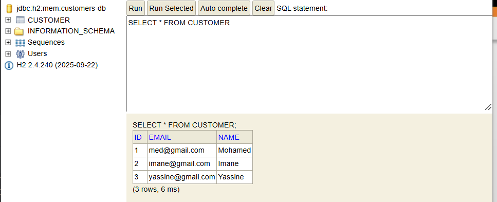
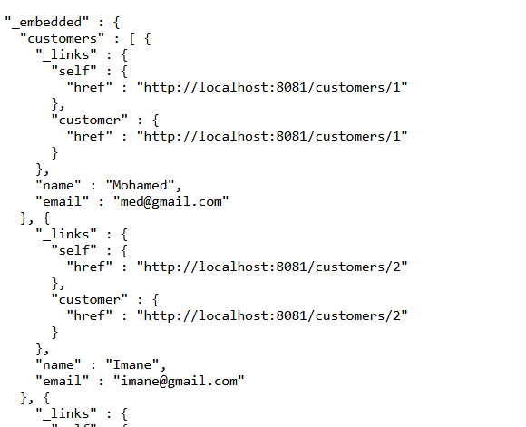

### 2. `inventory-service` microservice

Product management, with endpoint tests.

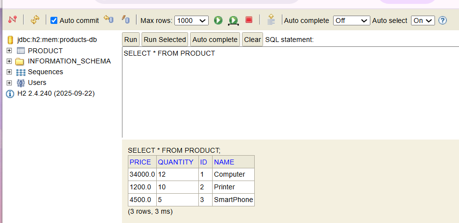
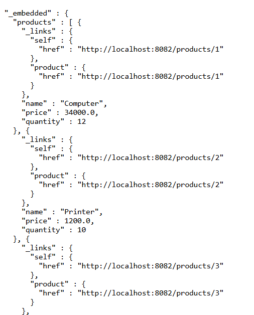

### Actuator

Checking the health and information of the services with Spring Boot Actuator.

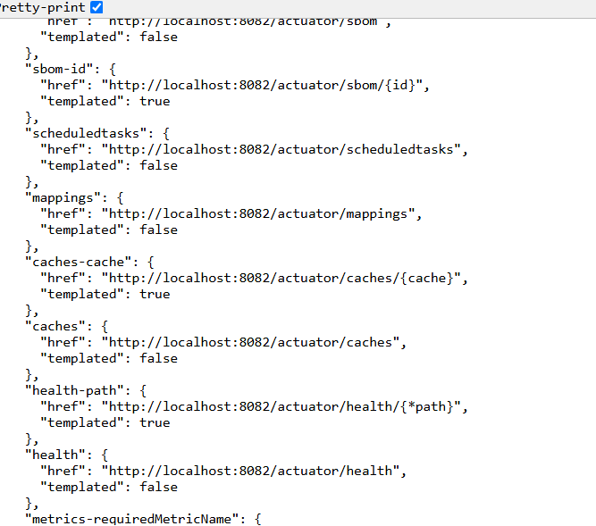

### 3 & 4. Spring Cloud Gateway and static route configuration

Setting up the Gateway and manually defining the routes to the microservices.

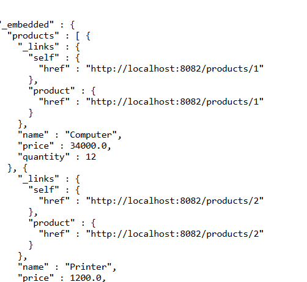

### 5. Eureka Discovery Service

The microservices register themselves automatically with Eureka.

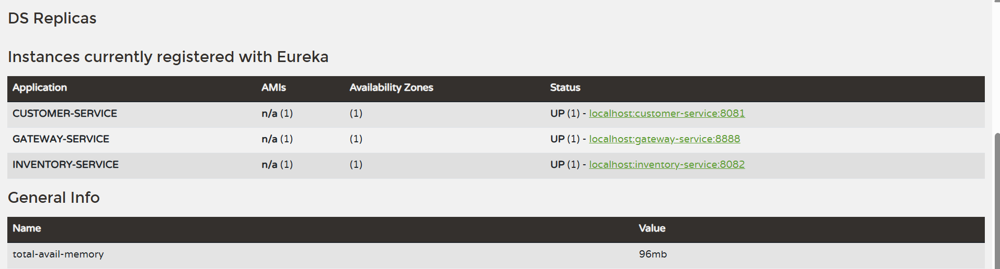

### 6. Dynamic Gateway route configuration

Routes are generated dynamically from the services registered in Eureka (`DiscoveryClientRouteDefinitionLocator`).

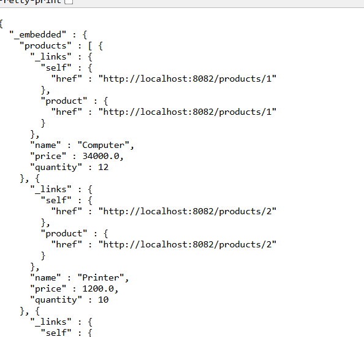

### 7. `billing-service` with OpenFeign

The billing-service queries `customer-service` and `inventory-service` through **OpenFeign** clients to build invoices (customer + products).

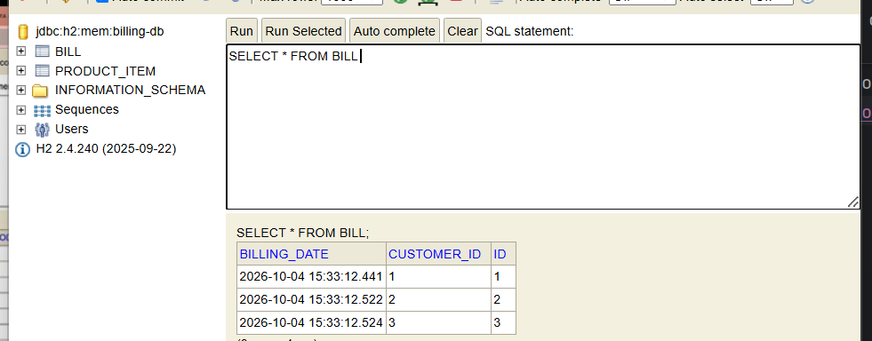
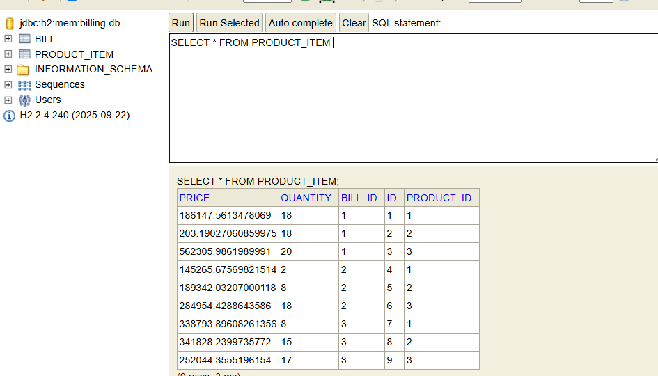
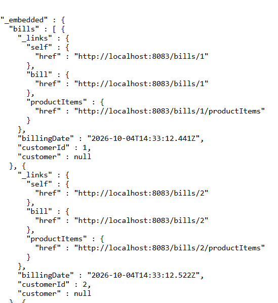

**REST controller:**

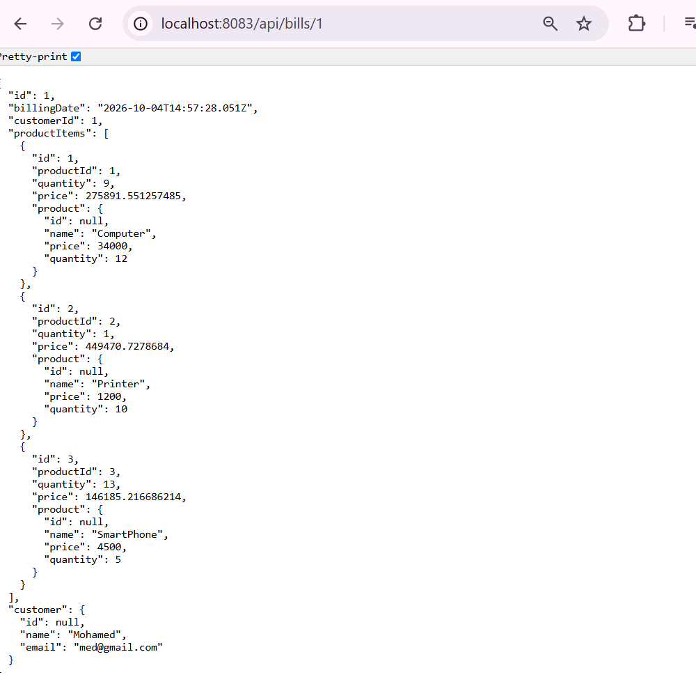

**Default customer (fallback):**

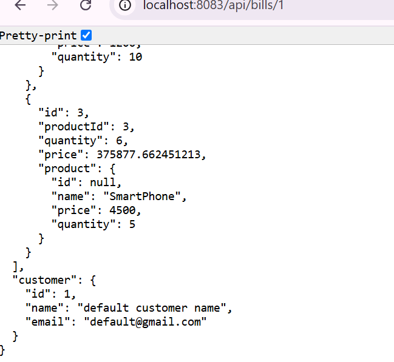

### 8. Config service (`config-service`)

Centralizing the microservices' configuration files in a Git repository.

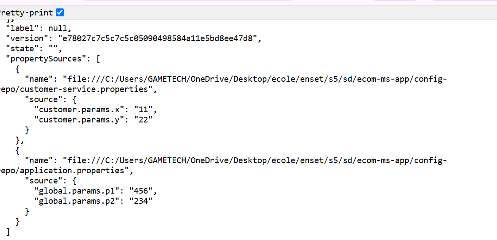

---

## Running the Project

> Follow this startup order:

1. `config-service`
2. `discovery-service` (Eureka)
3. `customer-service`
4. `inventory-service`
5. `billing-service`
6. `gateway-service`

```bash
# In each service's folder
mvn spring-boot:run
```

### Ports (adapt to your configuration)

| Service | Port |
|---|---|
| config-service | 9999 |
| discovery-service | 8761 |
| customer-service | 8081 |
| inventory-service | 8082 |
| billing-service | 8083 |
| gateway-service | 8888 |

### Example URLs (through the Gateway)

```
GET http://localhost:8888/CUSTOMER-SERVICE/customers
GET http://localhost:8888/INVENTORY-SERVICE/products
GET http://localhost:8888/BILLING-SERVICE/fullBill/1
```

Eureka dashboard: http://localhost:8761

---

## Project Structure

```
micro-services-app/
├── config-service/
├── discovery-service/
├── gateway-service/
├── customer-service/
├── inventory-service/
├── billing-service/
└── README.md
```